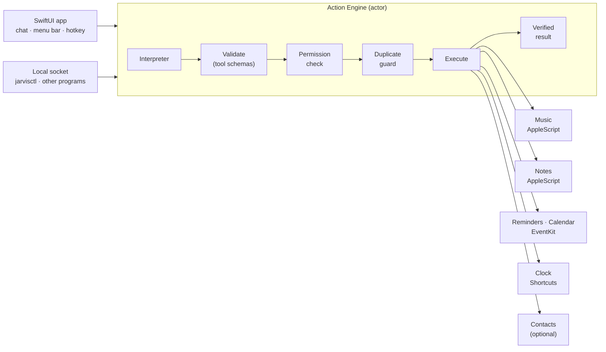

# Architecture

Jarvis Apple Integrations turns English or Spanish text into **verified actions** in Apple Music, Reminders, Notes,
Calendar and Clock. The design goal is that the *engine* is a reusable component with no UI, and that nothing the user
(or a language model) types can ever become executable code.



`text → interpreter → structured tool calls → validation → permission check → execution → verified result → response`

## Agent execution and configuration

The app now composes `ConfiguredAgentInterpreter`, which selects the user-configured `CompatibleModelProvider` first
when enabled and falls back to `DeterministicInterpreter` for ordinary offline commands. `HybridCommandInterpreter`
remains available to embedders. Settings are read per request; no restart is required. Credentials live in Keychain.

A `ToolPlan` with `continues = true` enters the bounded ActionEngine observation loop. Each batch is fully validated
before effects and consists of independent reads or one write. Results become untrusted data excerpts for the next
planning call. Failed/unsupported/cancelled steps stop the workflow; pending integration questions suspend its state.
Confirming resumes it, while a new instruction invalidates stale pending scope. Creation outcomes that could not be
verified are quarantined against blind repeats. The model never receives an execution or shell interface.

`InterpretationRequest` carries bounded session-scoped `ConversationTurn` data and current workflow observations.
Context is in memory and independently switchable from on-disk command history. Explicit optional aliases are stored
in settings and remain data. Tool schemas now include standard JSON Schema, safety, permissions and timeout metadata;
unknown reversibility is represented as unknown rather than promised.

Weather, numeric utilities and persistent Jarvis notification timers are separate registered integrations. Public
EventKit handles reminder recurrence and list changes; calendar analysis uses actual observed busy intervals. See
[UPGRADE.md](UPGRADE.md) for the full capability and platform-limit matrix.

## Modules

| Module (Swift package `JarvisKit`) | Contents | Depends on |
| --- | --- | --- |
| **JarvisCore** | Models (`ToolCall`, `ToolResult`, `EngineResponse`, `JSONValue`…), the tool **schema** and **registry**, argument **validation**, the `AppIntegration` protocol, the **Action Engine**, pending-action tokens, duplicate guard, history, settings, secret store, date helpers, language detector, logging | Foundation |
| **JarvisInterpreter** | The deterministic English/Spanish parser, the natural-date parser, and the pluggable AI plumbing (`LLMTextProvider`, `LLMToolCallInterpreter`, `HybridCommandInterpreter`) | JarvisCore |
| **JarvisIntegrations** | `MusicIntegration`, `NotesIntegration`, `RemindersIntegration`, `CalendarIntegration`, `ContactsIntegration`, `ClockIntegration`, the AppleScript runner, the EventKit backend, the Shortcuts runner, Automation permission | JarvisCore |
| **JarvisIPC** | Unix-socket NDJSON server and client, `EngineIPCHandler`, wire types | JarvisCore |
| **jarvisctl** | Command-line client of the socket | JarvisCore, JarvisIPC |
| **App** (Xcode project) | SwiftUI app: composition root, `AppModel`, views, menu bar, Settings, global shortcut | all of the above |

The package products can be embedded in another app (for example the wider Jarvis assistant) *without* the UI. The Xcode
project (`JarvisAppleIntegrations.xcodeproj`, generated from `project.yml`) holds only the app, the embedded `jarvisctl`
and the app-level tests.

## The Action Engine

`ActionEngine` is a Swift **actor**. One instance serves the window, the menu bar and the socket, so a confirmation
requested from one front-end is visible to the same rules as every other. For each command it:

1. **Interprets** the text (`CommandInterpreting`) into a `ToolPlan` — or a conversational reply, a clarifying question,
   or “not understood”. Language is the request's, else the user's fixed preference, else detected from the text, else the
   host's language.
2. **Validates** every call against the registry (`ToolValidator`): unknown tool → rejected; unknown parameter →
   rejected; missing required parameter, wrong type, out-of-range number, bad date or time, over-long string, control
   characters → rejected or normalised; defaults filled in; constraints such as *at most one of end/duration* enforced.
   Nothing reaches an integration unvalidated.
3. **Groups** steps by integration: steps of *different* integrations run **concurrently**, steps of the *same*
   integration run **in order**. If a step fails, needs input, or needs permission, the later steps of that integration are
   skipped and reported as such; other integrations are unaffected.
4. **Checks permission** per tool (`authorization(for:)`); when the state is “not determined” it asks
   (`requestAuthorization`), which shows the macOS prompt.
5. **Guards duplicates**: creation tools (`deduplicate: true`) that are identical to one running or finished within the
   duplicate window (default 8 s) are not run again. Read-only tools are never suppressed, and `next song` twice really
   skips two songs.
6. **Executes** with a hard per-tool deadline and cooperative cancellation. The integration returns one of
   `ToolOutcome.done`, `.confirm` (nothing changed yet; the engine stores a single-use, expiring token and asks) or
   `.clarify` (several matches; the user chooses).
7. **Verifies** — each integration reads its effect back before returning `done` — and **reports** a `ToolResult` with a
   status, a localized message, structured `data` (with real identifiers), a verification (`verified` / `unverified` with
   reason / `not applicable`), assumptions the interpreter made, warnings, and — when relevant — the permission or setup
   instructions needed.
8. **Records** the command in the history (unless the user switched that off).

Pending questions (confirmations and clarifications) live in `PendingActionStore`: tokens are random, single-use,
expire after 10 minutes, and are scoped to a session so a plain “yes”, “cancel”, “2” or “la primera” answers the most
recent question *of that session* (`ReplyClassifier`). A new non-answer instruction invalidates pending actions in that session so old buttons cannot apply a superseded scope.

## Tools: typed contracts

Every capability is a `ToolDescriptor` (`name`, `safety` — read-only / modifying / destructive —, typed `parameters`,
`constraints`, timeout, `deduplicate`, examples). The registry is the single source of truth for validation, for the AI
prompt, for [TOOLS.md](TOOLS.md) (generated from the live registry) and for the contract test that checks the parser
against the schemas. 39 tools are registered; their names live in `ToolName`'s static members.

## Interpreters

* **`DeterministicInterpreter`** — works offline and without any AI. Text is folded 1:1 (case and diacritics) so every
  rule can match accent-insensitively while quoted payloads and note content are *masked* and never parsed as commands.
  It splits multi-action sentences into clauses (“play X and remind me to Y”, with a command-start lexicon plus a
  conservative fallback), runs a rule set per domain (Music, Reminders, Notes, Calendar, Clock, Meta), and parses dates
  with `NaturalDateParser` (English and Spanish, relative days, weekdays, “next/this”, times with or without AM/PM,
  durations, ranges, DST-safe; ambiguous bare hours are resolved by a documented policy and **surfaced as an
  assumption** the user sees).
* **Custom AI plug-in (optional)** — implement `LLMTextProvider.complete(system:user:)` (Laya, a local model, a hosted API). The
  provided `LLMToolCallInterpreter` builds a prompt from the tool schemas and parses the answer with `AIProposalParser`.
  The output is **untrusted data**: it becomes `ProposedToolCall`s that go through exactly the same validation as
  everything else, so the worst a model can produce is a rejected call.
  `HybridCommandInterpreter` combines the two (rules first, AI for what the rules do not understand — or the reverse).

```swift
struct MyModel: LLMTextProvider {
    let identifier = "my-model"
    func complete(system: String, user: String) async throws -> String { /* call your model, return its text */ }
}
let interpreter = HybridCommandInterpreter(ai: LLMToolCallInterpreter(provider: MyModel()))
let environment = AppEnvironment(interpreter: interpreter)   // App/AppEnvironment.swift
```

## Integrations

Each integration conforms to `AppIntegration` (`tools`, `permissionRequirements`, `status()`, `authorization(for:)`,
`requestAuthorization(for:)`, `execute(_:context:)`). To add one: write the type, list it in
`IntegrationCatalog.makeDefault()`, add its tools' names to `ToolName`; the engine, validation, IPC, history and UI pick it
up unchanged.

| Integration | Backend | How results are verified |
| --- | --- | --- |
| Reminders | EventKit (`EKEventStore`) | The reminder is re-fetched by its identifier and compared; lists are matched across accounts and ambiguity is reported. Timed reminders get a real `EKAlarm`. |
| Calendar | EventKit | The event is re-fetched; recurring events are addressed per occurrence (`<eventIdentifier>|<start>`) and changed with `.thisEvent` only; duplicates and conflicts are checked before creating. |
| Music | AppleScript (`/usr/bin/osascript` child process) | The player state and current track are queried after the command; “playing” is reported only when the player state says so and the track matches. |
| Notes | AppleScript | The note is read back (title, folder, content); notes with attachments or passwords are never rewritten. |
| Clock | Apple Shortcuts (`shortcuts run`) | Alarms are re-listed through `Jarvis List Alarms` when that shortcut exists; otherwise the result is marked **unverified**. |
| Contacts | Contacts framework | Read-only lookup, off by default. |

### AppleScript, safely

Scripts are fixed text compiled into the app. User values are never spliced into script source: they are passed as
separate `osascript` arguments after `--` and read in AppleScript with `item N of argv`. Results come back as
ASCII-separated records (never locale-formatted numbers), dates as ISO strings. The runner is a child process — it can be
**cancelled**, has a **timeout** and an **output cap**, runs off the main thread, and (since it is a child of the app)
is attributed to the app for Automation consent. Every script is compile-checked against the installed Music and Notes
dictionaries by a test.

## Persistence

* **Settings** — one JSON blob in `UserDefaults` (`JarvisSettings`, forgiving decoder, clamped on read).
* **History** — a capped JSON file (`history.json`, mode `0600`) in Application Support.
* **Secrets** — `KeychainSecretStore` (for an optional AI provider's key). Nothing sensitive is stored elsewhere.
* No database, no iCloud, no network.

## The app

SwiftUI with the Observation framework. `AppEnvironment` is the composition root (engine, integrations, history, IPC);
`AppModel` (`@MainActor @Observable`) holds the conversation and drives the engine without blocking the UI (every command
runs in a cancellable `Task`; progress arrives as `EngineEvent`s). Scenes: the main window (sidebar of integrations,
chat, history), a `MenuBarExtra` popover, a Settings window. The global shortcut uses Carbon `RegisterEventHotKey`, which
needs no Accessibility or Input Monitoring permission. `AppShell` holds the shell preferences (Dock, menu bar, shortcut,
appearance) and `LaunchAtLogin` wraps `SMAppService`.

## Concurrency

Swift 6 language mode with strict concurrency. The engine, history store and EventKit backend are actors; integrations
and models are `Sendable`; UI state is `@MainActor`. Commands never block the main thread: they run in tasks, long
external calls are child processes or async EventKit calls with deadlines, and cancelling a task cancels the child
process.

## Testing strategy

See [TESTING.md](TESTING.md): 470 automated tests across five bundles with fake integrations and in-memory backends; a
parser↔schema contract test over ~100 English and Spanish phrases; compile checks of every AppleScript; real
`osascript`/socket tests for safety properties; and a separate, clearly-labelled list of what needs a human to approve a
macOS prompt.
